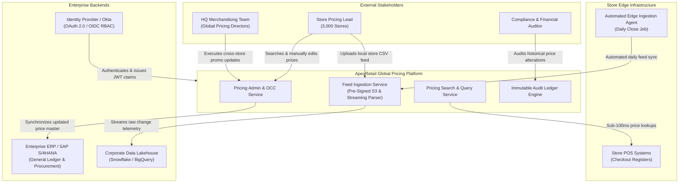
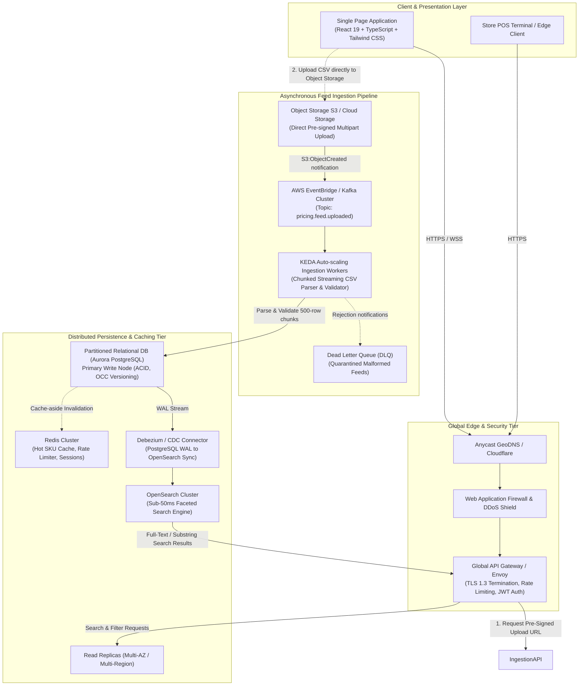
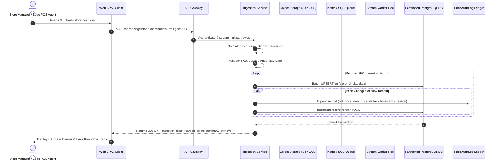
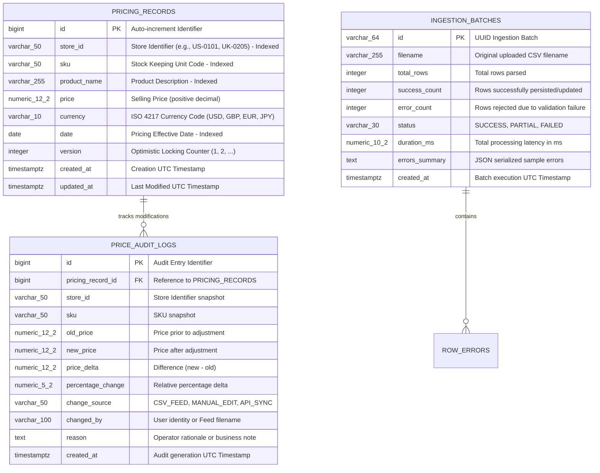

# ApexRetail Global Pricing Platform
## Architecture Design Document & System Specifications

---

### Table of Contents
1. [Executive Summary & Problem Statement](#1-executive-summary--problem-statement)
2. [Context Diagram (C4 Level 1)](#2-context-diagram-c4-level-1)
3. [Solution Architecture (C4 Level 2 Container Architecture)](#3-solution-architecture-c4-level-2-container-architecture)
4. [Data Ingestion Pipeline Sequence](#4-data-ingestion-pipeline-sequence)
5. [Entity-Relationship Data Model](#5-entity-relationship-data-model)
6. [Design Decisions & Trade-off Analysis (ADRs)](#6-design-decisions--trade-off-analysis-adrs)
7. [Non-Functional Requirements (NFR) Matrix & Solutions](#7-non-functional-requirements-nfr-matrix--solutions)
8. [Assumptions](#8-assumptions)
9. [Running the Application Locally & Verification](#9-running-the-application-locally--verification)

---

### 1. Executive Summary & Problem Statement

**ApexRetail** operates a global brick-and-mortar and omnichannel chain of **3,000 stores across 7 countries** (United States, United Kingdom, Germany, France, Japan, Canada, and Australia). Each store maintains an active catalog of 30,000 to 50,000 SKUs, resulting in **100,000,000 to 150,000,000 active pricing records** enterprise-wide.

The objective is to provide a single-pane-of-glass platform that enables:
1. **Feed Ingestion**: High-throughput upload and persistence of daily pricing feeds from stores using CSV format (`Store ID`, `SKU`, `Product Name`, `Price`, `Date`).
2. **Pricing Search & In-Place Editing**: Sub-100ms multi-criteria search and safe record editing protected by optimistic concurrency control and tamper-proof audit trails.
3. **Enterprise Non-Functional Capabilities**: Multi-region resilience, high availability (99.99%), horizontal scalability, data isolation, and multi-currency internationalization.

---

### 2. Context Diagram (C4 Level 1)

The System Context diagram illustrates how the Global Pricing Platform interacts with external stakeholders, store edge systems, and enterprise systems.



---

### 3. Solution Architecture (C4 Level 2 Container Architecture)

The solution follows a multi-tier, event-driven, decoupled microservices architecture designed to handle peak end-of-day feed bursts from 3,000 stores concurrently without degrading search or edit response times.



---

### 4. Data Ingestion Pipeline Sequence

The diagram below details the zero-memory-pressure ingestion flow using pre-signed cloud storage uploads:



---

### 5. Entity-Relationship Data Model

The data layer employs strict relational integrity for operational consistency, optimistic versioning, and an immutable audit log.



---

### 6. Design Decisions & Trade-off Analysis (ADRs)

| # | Architecture Decision | Alternatives Evaluated | Rationale & Trade-off |
|---|----------------------|------------------------|-----------------------|
| **ADR-01** | **Asynchronous / Streaming Micro-Batch Ingestion** | Synchronous row-by-row REST inserts | 3,000 stores uploading feeds creates massive burst concurrency. Streaming CSV parsing with 500-row micro-batch UPSERTs avoids memory bottlenecks and scales with backpressure. |
| **ADR-02** | **Optimistic Concurrency Control (OCC)** | Pessimistic `SELECT FOR UPDATE` table locks | In a high-throughput retail system, pessimistic locking degrades read performance and causes deadlocks during bulk feed windows. Adding a `version` field enables atomic conditional updates (`WHERE version = :expected_version`) and returns HTTP 409 Conflict if another operator or feed modified the record. |
| **ADR-03** | **Immutable Audit Ledger (`PriceAuditLog`)** | In-place overwrite with `last_modified` column | Retail compliance (SOX, pricing transparency laws, tax audits) forbids silent price overwrites. An append-only ledger provides an audit trail of who changed each price, old vs new value, delta percentage, and rationale. |
| **ADR-04** | **Composite Idempotency Key `(store_id, sku, date)`** | Surrogate key with separate daily history table | Ensures idempotent uploads: re-uploading the same file or re-running failed batches does not produce duplicate pricing records. It automatically updates changed prices and records version bumps. |
| **ADR-05** | **CQRS Segregation (Relational Write + OpenSearch Read)** | Single relational DB for both complex search & writes | Full-text substring search across 150M records with multi-criteria filters on a relational DB degrades under write contention. Syncing writes to OpenSearch provides sub-50ms query responses. |
| **ADR-06** | **ISO 4217 Currency Explicit Storage** | Implicit country-based currency derivation | Stores operate across US (USD), UK (GBP), Germany/France (EUR), Japan (JPY), Canada (CAD), and Australia (AUD). Explicitly storing currency code and integer decimal precision (e.g. 0 decimals for JPY, 2 for USD) prevents currency ambiguity. |
| **ADR-07** | **Zero-Tolerance Ingestion Validation Guardrails** | Lenient auto-correct ingestion | Prevents fat-finger catastrophic price drops (e.g. $999.00 -> $0.00). Files with negative prices, missing SKUs, or malformed dates reject the offending rows with clear row-by-row error logs while committing valid rows. |

---

### 7. Non-Functional Requirements (NFR) Matrix & Solutions

| NFR Category | Target Requirement | Architecture Implementation |
|--------------|-------------------|-----------------------------|
| **1. Scalability** | Support **3,000 retail stores** each holding 50k SKUs (**150M active records**). | • Partitioning tables declaratively by `country_code` and `store_id` hash.<br/>• Micro-batch streaming CSV parser (chunk size: 500-2,000 rows).<br/>• Auto-scaled worker pods using KEDA based on queue depth. |
| **2. High Availability** | **99.99% Uptime** (less than 52 minutes downtime/year). | • Multi-AZ active-active container deployments on Kubernetes (EKS/GKE).<br/>• Aurora Multi-AZ with automated sub-30s failover to read replicas.<br/>• Multi-region active-passive disaster recovery (RPO &lt; 1 min, RTO &lt; 5 min). |
| **3. Latency & Performance** | Sub-100ms multi-criteria search globally; sub-500ms record updates. | • OpenSearch inverted indices on `store_id`, `sku`, `product_name`, `price`, `date`.<br/>• Redis distributed caching for hot store price lookups.<br/>• SQLite WAL mode / PostgreSQL MVCC preventing readers from blocking writers. |
| **4. Data Integrity & Concurrency** | Zero lost updates during concurrent edits and bulk uploads. | • Optimistic Concurrency Control using integer `version` field.<br/>• Unique constraint on `(store_id, sku, date)`.<br/>• Atomic database transactions per micro-batch. |
| **5. Auditability & Compliance** | 100% trace of every price modification for 7-year regulatory compliance. | • Append-only `price_audit_logs` capturing operator, old price, new price, % delta, reason, timestamp.<br/>• Automated offloading of records older than 365 days to cold Parquet lakehouse storage (S3 Glacier). |
| **6. Security & RBAC** | Fine-grained access control across store managers vs HQ directors. | • OAuth 2.0 / OpenID Connect with JWT tokens scoped to store IDs.<br/>• HTTPS TLS 1.3 encryption in-transit and AES-256 at-rest.<br/>• Input sanitization preventing CSV formula injection and SQL injection. |
| **7. Internationalization** | Support multi-country retail operations across Americas, EMEA, and APAC. | • ISO 4217 currency tracking with locale-aware currency and date formatting.<br/>• Time-zone normalized UTC timestamps stored uniformly. |
| **8. Observability & Telemetry** | Proactive anomaly detection and ingestion pipeline monitoring. | • OpenTelemetry distributed tracing across API gateway and worker pods.<br/>• Prometheus metrics tracking ingestion throughput (rows/sec), error rates, and queue lag.<br/>• Alerts triggered when ingestion error rate exceeds 2% or price variance exceeds 80%. |

---

### 8. Assumptions

1. **Feed Frequency & File Cadence**: Stores generate a daily pricing feed at the close of business, with occasional ad-hoc intraday promotional updates.
2. **Catalog Master Data**: SKUs conform to the global enterprise catalog. Products sold internationally share a unified SKU prefix.
3. **Tax Handling**: European and UK feeds provide VAT-inclusive retail prices in accordance with local retail laws, while North American feeds provide pre-tax shelf prices. Country code in the Store ID denotes the applicable tax schema.
4. **Storage Retention**: Operational transactional databases retain current and trailing 365-day pricing records. Data older than 1 year is archived to the cloud data lake (Snowflake / AWS S3 Parquet).
5. **Network Connectivity**: Stores have reliable broadband internet but may experience transient connectivity drops; edge agents buffer feeds locally and retry uploads with exponential backoff.

---

### 9. Running the Application Locally & Verification

The solution is packaged for zero-friction local execution:

#### One-Click Run (Windows)
Double-click `run.bat` or run in PowerShell:
```powershell
.\run.ps1
```

#### Run with Python & Node (Manual)
```bash
# 1. Install backend dependencies
python -m pip install -r backend/requirements.txt

# 2. Build Frontend Single Page App
cd frontend
npm install
npm run build
cd ..

# 3. Start unified application
python backend/run.py
```

#### Docker Deployment
```bash
docker compose up --build -d
```

#### Application Endpoints
- **Single Page Web Application**: `http://localhost:8000`
- **Interactive OpenAPI Swagger Docs**: `http://localhost:8000/docs`
- **Health Check Endpoint**: `http://localhost:8000/health`
- **Unit & Integration Test Suite**:
  ```bash
  python -m pytest backend/tests/test_pricing.py -v
  ```
